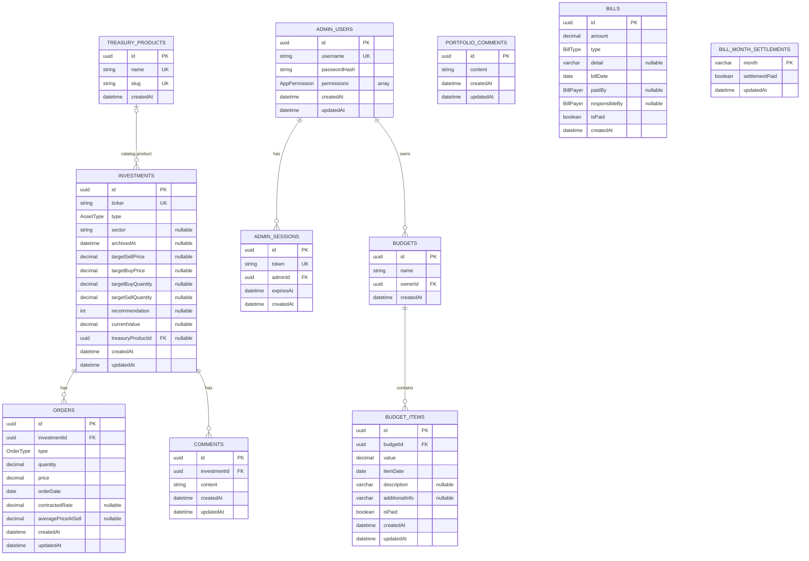

# Database schema

This document describes the PostgreSQL data model managed by Prisma. The source of truth is [`server/prisma/schema.prisma`](server/prisma/schema.prisma); update this document whenever a schema or migration change affects tables, columns, relationships, or enums.

## Relationships

`UK` marks a unique column, `PK` a primary key, and `FK` a foreign key. `nullable` marks optional columns. Prisma model names are mapped to the lowercase table names shown in the diagram.

## Columns

`String @id @default(uuid())` fields are UUIDs in PostgreSQL. `DateTime` fields use PostgreSQL timestamps unless noted as `@db.Date`. Decimal columns below use `NUMERIC(precision, scale)`.

### `treasury_products` (`TreasuryProduct`)

| Column | PostgreSQL type | Constraints and behavior |
|---|---|---|
| `id` | UUID | Primary key; generated UUID |
| `name` | TEXT | Required; unique |
| `slug` | TEXT | Required; unique |
| `createdAt` | TIMESTAMP | Required; defaults to current time |

### `investments` (`Investment`)

| Column | PostgreSQL type | Constraints and behavior |
|---|---|---|
| `id` | UUID | Primary key; generated UUID |
| `ticker` | TEXT | Required; unique |
| `type` | `AssetType` | Required; defaults to `STOCK` |
| `sector` | TEXT | Nullable |
| `archivedAt` | TIMESTAMP | Nullable |
| `targetSellPrice` | NUMERIC(18, 8) | Nullable |
| `targetBuyPrice` | NUMERIC(18, 8) | Nullable |
| `targetBuyQuantity` | NUMERIC(18, 8) | Nullable |
| `recommendation` | INTEGER | Nullable |
| `currentValue` | NUMERIC(18, 8) | Nullable |
| `treasuryProductId` | UUID | Nullable foreign key to `treasury_products.id` |
| `createdAt` | TIMESTAMP | Required; defaults to current time |
| `updatedAt` | TIMESTAMP | Required; maintained by Prisma on update |

### `orders` (`Order`)

| Column | PostgreSQL type | Constraints and behavior |
|---|---|---|
| `id` | UUID | Primary key; generated UUID |
| `investmentId` | UUID | Required foreign key to `investments.id`; delete restricted |
| `type` | `OrderType` | Required |
| `quantity` | NUMERIC(18, 8) | Required |
| `price` | NUMERIC(18, 8) | Required |
| `orderDate` | DATE | Required |
| `contractedRate` | NUMERIC(5, 2) | Nullable |
| `averagePriceAtSell` | NUMERIC(18, 8) | Nullable |
| `createdAt` | TIMESTAMP | Required; defaults to current time |
| `updatedAt` | TIMESTAMP | Required; maintained by Prisma on update |

### `comments` (`Comment`)

| Column | PostgreSQL type | Constraints and behavior |
|---|---|---|
| `id` | UUID | Primary key; generated UUID |
| `investmentId` | UUID | Required foreign key to `investments.id`; delete restricted |
| `content` | TEXT | Required |
| `createdAt` | TIMESTAMP | Required; defaults to current time |
| `updatedAt` | TIMESTAMP | Required; maintained by Prisma on update |

### `portfolio_comments` (`PortfolioComment`)

| Column | PostgreSQL type | Constraints and behavior |
|---|---|---|
| `id` | UUID | Primary key; generated UUID |
| `content` | TEXT | Required; 1–10000 characters |
| `createdAt` | TIMESTAMP | Required; defaults to current time |
| `updatedAt` | TIMESTAMP | Required; maintained by Prisma on update |

### `bills` (`Bill`)

| Column | PostgreSQL type | Constraints and behavior |
|---|---|---|
| `id` | UUID | Primary key; generated UUID |
| `amount` | NUMERIC(18, 2) | Required |
| `type` | `BillType` | Required; defaults to `OTHER` |
| `detail` | VARCHAR(500) | Nullable |
| `billDate` | DATE | Required; index with `createdAt` |
| `paidBy` | `BillPayer` | Nullable |
| `responsibleBy` | `BillPayer` | Nullable |
| `isPaid` | BOOLEAN | Required; defaults to `false` |
| `createdAt` | TIMESTAMP | Required; defaults to current time; index with `billDate` |

### `bill_month_settlements` (`BillMonthSettlement`)

| Column | PostgreSQL type | Constraints and behavior |
|---|---|---|
| `month` | VARCHAR(7) | Primary key; month in `YYYY-MM` format |
| `settlementPaid` | BOOLEAN | Required; defaults to `false` |
| `updatedAt` | TIMESTAMP | Required; maintained by Prisma on update |

### `admin_users` (`AdminUser`)

| Column | PostgreSQL type | Constraints and behavior |
|---|---|---|
| `id` | UUID | Primary key; generated UUID |
| `username` | TEXT | Required; unique |
| `passwordHash` | TEXT | Required; stores password hash |
| `permissions` | `AppPermission[]` | Required enum array; defaults to `[INVESTMENTS]` |
| `createdAt` | TIMESTAMP | Required; defaults to current time |
| `updatedAt` | TIMESTAMP | Required; maintained by Prisma on update |

### `admin_sessions` (`AdminSession`)

| Column | PostgreSQL type | Constraints and behavior |
|---|---|---|
| `id` | UUID | Primary key; generated UUID |
| `token` | TEXT | Required; unique |
| `adminId` | UUID | Required foreign key to `admin_users.id`; cascades on user deletion |
| `expiresAt` | TIMESTAMP | Required; indexed |
| `createdAt` | TIMESTAMP | Required; defaults to current time |

`admin_sessions.token` also has an explicit index in addition to its unique constraint. `bills` has a composite index on (`billDate`, `createdAt`).

### `budgets` (`Budget`)

| Column | PostgreSQL type | Constraints and behavior |
|---|---|---|
| `id` | UUID | Primary key; generated UUID |
| `name` | VARCHAR(200) | Required |
| `ownerId` | UUID | Required foreign key to `admin_users.id`; cascades on owner deletion |
| `createdAt` | TIMESTAMP | Required; defaults to current time |

The table has an index on (`ownerId`, `createdAt`) for owner-scoped budget listing.

### `budget_items` (`BudgetItem`)

| Column | PostgreSQL type | Constraints and behavior |
|---|---|---|
| `id` | UUID | Primary key; generated UUID |
| `budgetId` | UUID | Required foreign key to `budgets.id`; cascades on budget deletion |
| `value` | NUMERIC(18, 2) | Required; signed amount |
| `itemDate` | DATE | Required |
| `description` | VARCHAR(500) | Nullable |
| `additionalInfo` | VARCHAR(2000) | Nullable |
| `isPaid` | BOOLEAN | Required; defaults to `false` |
| `createdAt` | TIMESTAMP | Required; defaults to current time |
| `updatedAt` | TIMESTAMP | Required; maintained by Prisma on update |

The table has an index on (`budgetId`, `itemDate`, `createdAt`) for listing a budget's items.

## Enums

| Enum | Values |
|---|---|
| `AssetType` | `STOCK`, `TREASURY` |
| `OrderType` | `BUY`, `SELL`, `BONUS`, `SPLIT` |
| `BillPayer` | `HENRIQUE`, `AMANDA` |
| `BillType` | `INTERNET`, `CLEANING`, `CONDOMINIO`, `ENERGY`, `CARD`, `OTHER`, `RECEIVED` |
| `AppPermission` | `INVESTMENTS`, `BILLS_CONTROL`, `BUDGET`, `ADMIN` |

## Updating this reference

When a Prisma model, field, relation, index, or enum changes, update this file in the same change. Check the migration as well as `schema.prisma` so the reference reflects the database change that will be applied.
